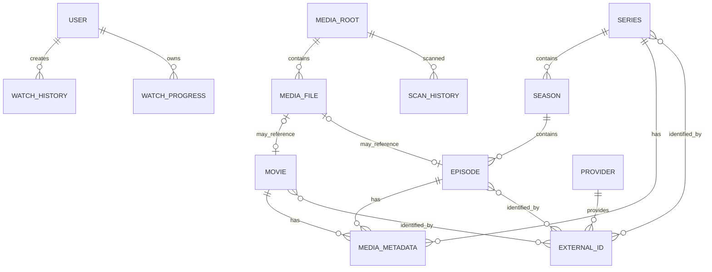

# MyVidLib - Modèle de données proposé

**Statut :** PROPOSÉ. EF Core ne doit pas être généré avant validation des points marqués À DÉFINIR.

## Diagramme conceptuel

## Entités principales

### User

Identité locale de profil. `Id`, `Name`, `Role`, `IsEnabled`, `CreatedAt`, `LastLoginAt` À DÉFINIR.

- Unicité : nom normalisé.
- Rôles obligatoires : `Administrator`, `User`.
- Deux profils sont minimums dans le périmètre initial.

### MediaRoot

Source configurée : `Id`, `DisplayName`, `AbsolutePath`, `IsEnabled`, `IsNetworkPath`, `LastScanAt`, `CreatedAt`.

- La suppression retire les associations de la racine mais ne supprime jamais les fichiers.
- Comportement des chemins réseaux après disparition à préciser.

### MediaFile

Représentation physique : `Id`, `MediaRootId`, `RelativePath`, `AbsolutePath`, `FileName`, `Extension`, `SizeBytes`, `CreatedAtSource`, `ModifiedAtSource`, `Duration`, `Width`, `Height`, `VideoCodec`, `AudioCodec`, `AudioTrackCount`, `SubtitleTracks`, `FrameRate`, `Fingerprint`, `AvailabilityStatus`, `LastSeenAt`.

- L'unicité de chemin doit être `(MediaRootId, RelativePath)`.
- Empreinte : méthode à définir. Elle ne doit pas être rendue obligatoire avant décision.
- Statuts : `Present`, `Missing`, `Unavailable` à confirmer.
- Suppression : la suppression de la racine enlève ou marque ses fichiers selon une règle à arbitrer.

### Movie

Œuvre interne : `Id`, `Title`, `OriginalTitle`, `SortTitle`, `ReleaseYear`, `Synopsis`, `Duration`, `Director`, `CastSummary`, `Rating`, `PosterPath`, `BackdropPath`, `CreatedAt`, `UpdatedAt`.

- Plusieurs fichiers peuvent représenter des versions ou doublons du même film ; cardinalité finale à définir.
- Proposition initiale : relation plusieurs-à-plusieurs via une entité de liaison afin de gérer les versions.

### Series

Œuvre interne : `Id`, `Title`, `OriginalTitle`, `SortTitle`, `Status`, `Synopsis`, `PosterPath`, `BackdropPath`, `ContentKind` (`Movie`, `Series`, `Anime`), `CreatedAt`, `UpdatedAt`.

### Season

`Id`, `SeriesId`, `SeasonNumber`, `Title`, `Synopsis`, `PosterPath`.

- Unicité : `(SeriesId, SeasonNumber)`.
- Gestion des saisons inconnues/spéciales à définir.

### Episode

`Id`, `SeasonId`, `EpisodeNumber`, `DisplayNumber` À DÉFINIR, `Title`, `Synopsis`, `AirDate`, `Duration`, `ThumbnailPath`, `EpisodeKind` (`Standard`, `Special`, `OAV`, `Double`).

- Peut exister sans `MediaFile`.
- Unicité primaire : `(SeasonId, EpisodeNumber, EpisodeKind)` peut ne pas suffire pour les doubles épisodes.

### MediaMetadata

Valeurs enrichies avec provenance : `Id`, `SubjectType`, `SubjectId`, `FieldName`, `ValueJson`, `ProviderId`, `Locale`, `IsCanonical`, `FetchedAt`, `ExpiresAt`.

- Permet de conserver plusieurs traductions et plusieurs catalogages.
- Une valeur canonique doit être explicitement sélectionnée.

### ExternalId

`Id`, `ProviderId`, `EntityType`, `EntityId`, `ProviderValue`, `MatchConfidence`, `MatchStatus`, `CreatedAt`, `ValidatedAt`, `ValidatedByUserId`.

- Unicité : `(ProviderId, EntityType, ProviderValue)`.
- Statuts : `Automatic`, `Confirmed`, `Rejected`, `Manual`.

### Provider

`Id`, `Code`, `Name`, `IsEnabled`, `Priority`, `BaseUrl`, `LastSuccessAt`, `LastErrorAt`.

- Priorités distinctes par type de contenu à définir.
- Les secrets ne sont jamais des propriétés du modèle persistant.

### ScanHistory

`Id`, `MediaRootId`, `StartedAt`, `CompletedAt`, `ScanType`, `Status`, `FilesDiscovered`, `FilesUpdated`, `FilesMissing`, `FilesFailed`, `ErrorSummary`.

- Une ligne par exécution.

### WatchHistory

`Id`, `UserId`, `MediaFileId`, `MovieId` ou `EpisodeId`, `StartedAt`, `CompletedAt`, `Source` (`Manual`, `Player`).

- Une ligne peut pointer vers un film ou épisode, à modéliser comme deux clés nullables ou tables spécialisées.

### WatchProgress

`Id`, `UserId`, `MediaFileId`, `MovieId` ou `EpisodeId`, `PositionTicks`, `DurationTicks`, `Status`, `UpdatedAt`, `LastWatchedAt`.

- Unicité proposée : `(UserId, MediaFileId)`.
- Sauvegarde atomique pendant la lecture.

### ApplicationSettings

`Id`, `Key`, `ValueJson`, `Scope`, `UpdatedAt`.

- Éviter les colonnes de paramètres fortement dispersées.
- Certains secrets doivent être gérés par une API locale sécurisée ou le stockage Windows, à définir.

## Relations

- `MediaRoot` 1,N `MediaFile`.
- `MediaFile` N,1 au plus une œuvre locale selon les liens proposés.
- `Series` 1,N `Season`; `Season` 1,N `Episode`.
- `Episode` peut avoir zéro ou plusieurs `MediaFile`.
- Métadonnées externe et interne indépendantes ; aucune relation obligatoire avec un provider.
- Les utilisateurs possèdent des historiques/progressions séparés.

## Règles de suppression

- Suppression d'une source : suppression des liens, conservation ou mise à `Missing` des `MediaFile` selon arbitrage.
- Suppression d'un utilisateur : suppression ou anonymisation de son historique selon politique à définir.
- Suppression d'une œuvre : vérifier les liens avec les fichiers avant suppression ; aucune suppression physique.

## Index recommandés

- `MediaFile.AbsolutePath` unique si normalisé.
- `MediaFile.Fingerprint`.
- `MediaFile.LastSeenAt`.
- `Episode(SeasonId, EpisodeNumber)`.
- `ExternalId(ProviderId, ProviderValue)`.
- `WatchProgress(UserId, UpdatedAt)`.
- `WatchHistory(UserId, LastWatchedAt)`.
- `MediaMetadata(SubjectType, SubjectId, ProviderId, Locale)`.

## Décisions avant implémentation EF Core

1. Table de liaison fichier/œuvre ou relation N:1.
2. Méthode et stockage de l'empreinte.
3. Gestion des fichiers supprimés.
4. Modélisation des versions VF/VOSTFR.
5. Représentation des épisodes doubles/spéciaux.
6. Intégration du modèle d'utilisateur avant ou après M7.
7. Soft delete pour les œuvres, fichiers et utilisateurs.

Voir [architecture](SOFTWARE_ARCHITECTURE.md) et [comparateur](../02_FEATURES/EPISODE_COMPARATOR.md).