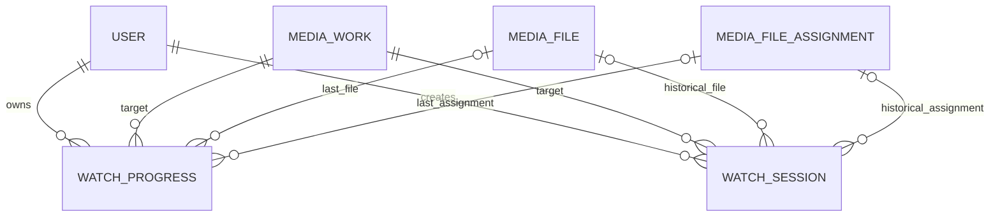

# MyVidLib — Modèle de données conceptuel V2.2.1

**Version :** Conceptuelle V2.2.1
**Date :** 21/11/2026
**Statut :** PROPOSÉ — EN ATTENTE DE VALIDATION HUMAINE.
**Périmètre :** conception conceptuelle uniquement ; aucune implémentation EF Core ou base de données ne doit être créée avant arbitrage.

## 1. Statut et périmètre

Ce document est la référence conceptuelle consolidée du catalogue, du stockage physique, des métadonnées, des utilisateurs et du suivi de visionnage.

Il conserve les décisions validées suivantes :

- le catalogue est indépendant des fournisseurs externes ;
- une œuvre est distincte d'un fichier physique ;
- plusieurs fichiers peuvent représenter une même œuvre ;
- la disponibilité locale, l'existence du catalogue et le visionnage sont indépendants ;
- les fichiers originaux ne sont jamais déplacés, renommés ou supprimés automatiquement ;
- les utilisateurs sont intégrés dès V1 ;
- les catalogues et sources sont partagés ; les préférences et progressions sont individuelles ;
- les données locales restent accessibles hors ligne.

Le périmètre initial conserve `Movie`, `Series` et `Episode` comme valeurs du discriminateur `WorkType` de `MediaWork`. Anime est une classification explicite et extensible, non une spécialisation structurelle.

### Statuts de décision

- **VALIDÉ** — principes établis par le propriétaire dans les documents de référence : `MediaWork` et ses trois types TPH, épisodes obligatoirement rattachés par `SeriesWorkId` à une série avec saison facultative, séparation œuvres/versions/fichiers, associations plusieurs-à-plusieurs avec rôles `Primary`, `Alternative`, `Part`, `Segment`, `Other`, classification Anime, `StoryArc`, suivi individuel par œuvre avec position en millisecondes relative à l'œuvre, distinction sessions/progression, identifiants typés, disponibilité indépendante des racines et fichiers, priorité fournisseurs configurable, archivage logique et protection des fichiers originaux.
- **PROPOSÉ** — recommandations de cette conception, notamment les champs de segment, les clés composites, les règles de sélection de métadonnées et les index Windows/SQLite ci-dessous ; elles attendent validation.
- **À ARBITRER** — décisions non prises, récapitulées à la section 19.

Les éléments ajoutés en V2.2 et V2.2.1 qui ne figurent pas dans la liste des principes VALIDÉS restent des recommandations PROPOSÉES ; leur présence dans le modèle ne vaut pas validation du propriétaire.

## 2. Principes de conception

1. **Identité stable** — `MediaWork.Id` identifie une œuvre dans MyVidLib. Il ne porte aucun identifiant fournisseur.
2. **Séparation du logique et du physique** — une œuvre, une version, une partie et un fichier sont des concepts distincts.
3. **Relations explicites** — toute relation fichier/œuvre ou épisode/fichier utilise une entité de liaison.
4. **Relations référentielles sûres** — aucune relation polymorphique ne sert d'ancre aux identifiants externes ou métadonnées.
5. **Traçabilité** — fournisseurs, récupérations, validations humaines et valeurs retenues restent distingués.
6. **Archivage par défaut** — les suppressions importantes utilisent un état actif/archivé ; elles ne déclenchent pas de cascade destructrice.
7. **États indépendants** — une racine, un fichier, une œuvre et un utilisateur possèdent chacun leur propre disponibilité ou cycle de vie.
8. **Indexabilité** — les chemins normalisés et les index sont définis pour éviter les duplications accidentelles sans imposer une empreinte coûteuse.

## 3. Diagramme conceptuel global

```mermaid
erDiagram
  MEDIA_WORK ||--o{ SEASON : series_work_id
  SEASON o|--o{ MEDIA_WORK : episode_season_id_when_episode
  MEDIA_WORK ||--o{ MEDIA_WORK : episode_series_work_id
  PROVIDER ||--o{ EPISODE_EXTERNAL_REFERENCE : provides
  EPISODE_EXTERNAL_REFERENCE ||--o{ EPISODE_EXTERNAL_MAPPING : maps_to
  MEDIA_WORK ||--o{ EPISODE_EXTERNAL_MAPPING : episode_work_id
  MEDIA_WORK ||--o{ STORY_ARC : series_work_id
  STORY_ARC ||--o{ EPISODE_STORY_ARC : arc_id
  MEDIA_WORK ||--o{ EPISODE_STORY_ARC : episode_work_id
  MEDIA_WORK ||--o{ MEDIA_VERSION : has
  MEDIA_WORK ||--o{ MEDIA_WORK_RELATION : source_work_id
  MEDIA_WORK ||--o{ MEDIA_WORK_RELATION : target_work_id
  MEDIA_WORK ||--o{ MEDIA_FILE_ASSIGNMENT : associated_with
  MEDIA_VERSION o|--o{ MEDIA_FILE_ASSIGNMENT : same_work_version
  MEDIA_ROOT ||--o{ MEDIA_FILE : contains
  MEDIA_FILE ||--o{ MEDIA_FILE_ASSIGNMENT : assigned
  MEDIA_FILE ||--o{ MEDIA_FINGERPRINT : fingerprinted
  MEDIA_ROOT ||--o{ MEDIA_SCAN : scanned
  MEDIA_SCAN ||--o{ MEDIA_SCAN_ERROR : reports
  MEDIA_SCAN ||--o{ MEDIA_SCAN_SCOPE : records
  USER ||--o{ WATCH_PROGRESS : owns
  USER ||--o{ WATCH_SESSION : creates
  MEDIA_WORK ||--o{ WATCH_PROGRESS : tracked
  MEDIA_WORK ||--o{ WATCH_SESSION : tracked
  MEDIA_FILE o|--o{ WATCH_SESSION : historical_file
  MEDIA_FILE o|--o{ WATCH_PROGRESS : last_file
  MEDIA_FILE_ASSIGNMENT o|--o{ WATCH_PROGRESS : last_assignment
  MEDIA_FILE_ASSIGNMENT o|--o{ WATCH_SESSION : historical_assignment
  PROVIDER ||--o{ MEDIA_WORK_EXTERNAL_ID : provides
  MEDIA_WORK ||--o{ MEDIA_WORK_EXTERNAL_ID : identifies
  PROVIDER ||--o{ SEASON_EXTERNAL_ID : provides
  SEASON ||--o{ SEASON_EXTERNAL_ID : identifies
  MEDIA_WORK ||--o{ MEDIA_WORK_METADATA : candidates
  SEASON ||--o{ SEASON_METADATA : candidates
  PROVIDER o|--o{ MEDIA_WORK_METADATA : provenance
  PROVIDER o|--o{ SEASON_METADATA : provenance
  CLASSIFICATION ||--o{ MEDIA_WORK_CLASSIFICATION : classifies
  MEDIA_WORK ||--o{ MEDIA_WORK_CLASSIFICATION : classified_as
```

`MediaWork` est une seule table avec `WorkType` comme discriminateur. Le diagramme ne suppose pas de tables `Movie`, `Series` ou `Episode` séparées. `Season` référence la ligne `MediaWork` dont `WorkType` vaut `Series`; les colonnes propres à Episode ne sont renseignées que lorsque `WorkType` vaut `Episode`.

## 4. Présentation des entités

### MediaWork

Entité commune de toutes les œuvres locales. Elle porte l'identité interne stable et les propriétés partagées : titre interne, titre original de travail, titre de tri, statut de catalogue, dates de création/modification, archive et provenance de la fiche. Dans la ligne TPH d'un épisode, `SeriesWorkId` est obligatoire et `SeasonId` facultatif.

Les propriétés propres à chaque spécialisation sont séparées :

| Spécialisation | Propriétés propres principales |
|---|---|
| Movie | date ou année de sortie, durée de référence (DurationMs) |
| Series | statut de diffusion, nombre de saisons, période de diffusion |
| **Episode** | **SeriesWorkId obligatoire, SeasonId facultatif ; numéro interne éventuel, date de diffusion, durée de référence (si connue, la durée de l'épisode en millisecondes relative au début de l'épisode), type d'épisode |

**Pour les épisodes :**
- L'entité MediaWork d'un épisode porte SeriesWorkId obligatoire, car il appartient obligatoirement à une série. L'épisode peut exister sans saison connue (SeasonId = null).
- **La propriété DurationMs sur un épisode représente la durée totale de l'épisode en millisecondes, relative au début de l'épisode**. Elle est facultative et doit être déterminée par FFprobe ou renseignée manuellement. Une valeur nulle indique que la durée est inconnue. Cette durée peut différer des bornes WorkStartMs/WorkEndMs d'une association Part spécifique : une partie d'un épisode ne couvre pas nécessairement toute sa durée. Un épisode sans fichier associé (MediaFileAssignment) n'a pas de durée connue ; son DurationMs sera nul jusqu'à ce qu'une association soit faite et que FFprobe fournisse la durée.

**WorkType vaut Movie, Series ou Episode.** Les colonnes propres à un type restent conceptuellement séparées et nulles pour les autres types. Pour une ligne Episode, SeriesWorkId désigne une ligne MediaWork de type Series; la saison peut rester inconnue (SeasonId = null) sans perdre l'appartenance à la série. Une classification contrôlée et extensible (Classification, MediaWorkClassification) identifie notamment Anime sans ajouter de type structurel.

Episode est toujours une œuvre selon le modèle. Il ne représente pas un fichier, une partie ni une version.
### MediaWorkRelation

Relation narrative ou éditoriale entre deux œuvres. Elle porte le type de relation et permet plusieurs relations pour une même œuvre.

Types de départ recommandés : `Adaptation`, `Prequel`, `Sequel`, `SpinOff`, `DerivedFilm`, `Related`, `Parent`, `Child`. La relation porte deux clés étrangères distinctes et obligatoires, `SourceWorkId` et `TargetWorkId`. Une œuvre ne peut pas être sa propre relation.

Une relation ne remplace pas l'appartenance d'un épisode à une saison. Une relation entre une série et un film dérivé reste possible.

### Season

Regroupe les épisodes d'une série. Elle porte un identifiant interne stable, `SeriesWorkId`, `SeasonKind` (`Normal`, `Special`, `Unknown`), `SeasonNumber` (numéro métier local et nullable uniquement pour `Unknown`), `SortOrder` (ordre de tri interne obligatoire), son titre et ses métadonnées.

La recommandation **PROPOSÉE** est de représenter les épisodes spéciaux couramment catalogués comme saison 0 par `SeasonKind = Special`, `SeasonNumber = 0`. Une seule saison spéciale 0 est permise par série. Une saison `Unknown` a `SeasonNumber = null` et son propre `SortOrder`; une seule est permise par série. Les numéros de saison des fournisseurs restent distincts dans `SeasonExternalId`.

### Episode

`Episode` est toujours rattaché à une série par `SeriesWorkId` ; `SeasonId` est facultatif. Il peut exister sans fichier ou sans saison connue.

Conserver `SeriesWorkId` sur l'épisode permet le rattachement même lorsque la saison est inconnue. Lorsque `SeasonId` est renseigné, la clé composite `(SeriesWorkId, SeasonId)` garantit que la saison appartient à cette même série ; l'identifiant direct de série évite de déduire une relation obligatoire depuis une saison qui peut être absente.

Elle distingue au minimum : `Standard`, `Special`, `OAV`, `ONA` et d'autres types justifiés. Un arc narratif n'est pas un type d'épisode. Les numéros internes sont propres à MyVidLib ; les identifiants, numéros et regroupements externes sont conservés dans des références de catalogue par fournisseur.

`EpisodeGroup` / `EpisodeGroupMember` ne sont pas retenus : un fichier réunissant plusieurs épisodes est représenté par plusieurs `MediaFileAssignment`, et un épisode découpé est représenté par plusieurs associations portant des numéros de partie. Les regroupements propres à un fournisseur relèvent de `EpisodeExternalReference` et de ses mappings, pas de la hiérarchie locale des saisons ni des affectations de fichiers.

Cas de modélisation :

1. **Un fichier contient plusieurs épisodes complets** : le même `MediaFileId` est associé à chaque `Episode` par une `MediaFileAssignment` distincte, avec les limites `SegmentStartMs` et `SegmentEndMs` lorsque connues. Les bornes permettent le seek dans le fichier ; le numéro de lecture peut ordonner les associations du même fichier.
2. **Un épisode est découpé en plusieurs fichiers** : plusieurs `MediaFileAssignment` pointent vers le même épisode ; `PartNumber` identifie les parties et `PlaybackOrder` donne leur ordre de lecture dans la même œuvre/version. Chaque fichier conserve son identité physique.
3. **Les fournisseurs regroupent ou numérotent différemment** : chaque référence externe garde ses numéros et son identifiant ; `EpisodeExternalMapping` relie la référence à un ou plusieurs épisodes internes. Les correspondances restent distinctes des fichiers et peuvent demander validation humaine.

`EpisodeGroup` n'est donc pas nécessaire pour exprimer le contenu d'un fichier ni une numérotation fournisseur. Un futur besoin métier de regroupement éditorial interne autonome devrait être arbitré séparément, sans détourner cette relation de fichier.

### StoryArc

Regroupement narratif facultatif d'épisodes appartenant à une série. `StoryArc.SeriesWorkId` référence la série ; `EpisodeStoryArc` relie un arc à un ou plusieurs épisodes. Un épisode peut participer à plusieurs arcs. Un arc ne remplace jamais une saison et n'est pas un type d'épisode. Chaque association impose que l'épisode ait le même `SeriesWorkId` que l'arc.

### Classification

Taxonomie contrôlée et extensible (code stable, libellé et éventuellement parent) reliée à `MediaWork` par `MediaWorkClassification`. Le code `Anime` permet recherche, filtres, priorité de fournisseur et règles de catalogue sans recourir à une chaîne libre.

### MediaRoot

Racine de stockage configurée : dossier local, lecteur externe ou partage réseau. Elle possède un état unique `AvailabilityStatus` : `Accessible`, `Inaccessible`, `Disabled`, `Unknown`. `Disabled` représente une désactivation volontaire, pas une panne.

La désactivation ou l'archivage est préférable à la suppression définitive.

### MediaFile

Représentation d'un fichier physique unique dans une racine. Ses attributs comprennent le chemin relatif, le nom, l'extension, la taille, les dates source, les résultats FFprobe, `AvailabilityStatus`, `LastSeenAt` (dernière observation) et `LastVerifiedAt` (dernière vérification fiable de présence ou d'absence).

`RelativePath` préserve le chemin observé pour affichage ; `NormalizedRelativePath` est la clé canonique de comparaison et d'unicité décrite à la section 7.

Les états sont `Present`, `Missing`, `Unknown`. `Missing` n'est permis qu'après vérification fiable de l'absence dans une zone complètement énumérée d'une racine accessible.

La suppression d'une racine n'affecte ni l'enregistrement du fichier ni sa méthode d'archivage, sauf à avoir été explicitement confirmée par une politique distincte.

En V1, `MediaFile` représente les fichiers vidéo indexés ; les informations de pistes audio/sous-titres intégrées sont des données techniques du fichier. Les fichiers de sous-titres externes ne sont pas assimilés à des œuvres ou à des versions vidéo et restent hors périmètre de l'indexation initiale. **Recommandation :** les modéliser ultérieurement comme ressources annexes reliées au fichier vidéo (ou à sa version si réellement éditoriales), plutôt que comme `MediaFile` vidéo.

### MediaVersion

Version éditoriale appartenant à une œuvre : VF, VOSTFR, VO, remaster, édition alternative ou autre variante. La résolution, les codecs, les pistes et les propriétés mesurées appartiennent au fichier, pas à la version.

Une version n'est pas une œuvre indépendante. Elle peut être inconnue ou partiellement décrite. Plusieurs fichiers peuvent appartenir à une même version. Une langue/variante éditoriale stable appartient à la version ; les pistes réellement détectées appartiennent au fichier. Une langue propre à une association n'est conservée sur celle-ci que lorsqu'elle diffère de la version.

### MediaFileAssignment

Lien explicite plusieurs-à-plusieurs entre une œuvre et un fichier physique. `MediaWorkId` et `MediaFileId` sont obligatoires ; `MediaVersionId` est facultatif. Il contient uniquement les données propres à l'association :

- version concernée, si connue ;
- rôle contrôlé : `Primary`, `Alternative`, `Part`, `Segment`, `Other` ;
- `PlaybackOrder`, facultatif hors rôle `Segment` ;
- `PartNumber`, requis pour le rôle `Part` et réservé à une partie d'une œuvre découpée ;
- `WorkStartMs` et `WorkEndMs`, bornes de la partie sur la timeline de l'œuvre (en millisecondes, avec précision au milliseconde) ; requises pour une association `Part` confirmée ou manuelle (nulles possibles tant qu'elle est `Proposed`) ; **ces valeurs doivent être relatives au début de l'épisode (`MediaWork.StartMs = 0`)** ;
- `SegmentStartMs` et `SegmentEndMs`, bornes physiques facultatives dans le fichier, utiles aux rôles `Part` et `Segment` ;
- langue ou variante seulement si elle n'est pas déjà définie par la version ;
- date d'association ;
- `MatchStatus` de correspondance et score éventuel ;
- `IsArchived`.

Le statut de rapprochement est contrôlé : `Proposed`, `Confirmed`, `Rejected`, ou `Manual`. **Règles PROPOSÉES :** `SegmentStartMs` et `SegmentEndMs` sont renseignés ensemble ou restent tous deux nuls ; le début est positif ou nul et la fin est strictement supérieure au début. Si la durée du fichier est connue, la fin ne peut la dépasser. La cohérence des segments entre eux (chevauchement ou limites de durée) est également vérifiée avant validation de l'association.

**Règles pour les parties (`Part`) :**
- **Calcul initial des bornes :** si toutes les associations `Part` d'une même œuvre/version ont une durée physique connue (FFprobe) et qu'aucune discontinuité n'est détectée, la première partie peut avoir `WorkStartMs = 0`, puis chaque autre partie peut avoir `WorkStartMs = WorkEndMs de la partie précédente`. Ces bornes initiales doivent être **explicitement validées** ; elles ne sont pas recalculées automatiquement à chaque lecture.
- Si une durée physique est inconnue ou si les parties ne forment pas une continuité parfaite, les bornes `WorkStartMs` et `WorkEndMs` doivent être renseignées explicitement par l'utilisateur ou un processus de validation humaine, car toute déduction automatique suppose une hypothèse qui peut être fausse.
- **Rôle Alternative** : une association `Alternative` complète (sans segments) n'a pas de `WorkStartMs`/`WorkEndMs`. Son intervalle logique est `[0, Duration du fichier)` ; elle ne représente qu'une portion alternative d'une œuvre ou version, pas un fragment.
- Un épisode peut avoir plusieurs associations `Part` et une association `Alternative`, chacune avec ses propres bornes logiques.

Quand `MediaVersionId` est renseigné, une contrainte référentielle composite doit garantir que la version appartient à la même œuvre que l'association : le couple `(MediaWorkId, MediaVersionId)` de l'association référence `(MediaWorkId, Id)` de `MediaVersion`. Une simple validation de l'interface ne suffit pas.

Portée de l'ordre et des parties :

- `Segment` : `PlaybackOrder` est obligatoire et positif, relatif aux segments du même `MediaFileId`. Pour une association confirmée/manuelle, `SegmentStartMs` et `SegmentEndMs` sont tous deux requis afin de localiser l'épisode dans le fichier ; leur ordre doit correspondre à `PlaybackOrder`. Ces bornes physiques ne remplacent pas la position logique relative à l'épisode.
- **`Part`** : **`PartNumber` est obligatoire et positif ; il identifie la partie et détermine l'ordre par défaut pour le même `(MediaWorkId, MediaVersionId)`**. `PlaybackOrder`, s'il est renseigné, est unique dans cette portée et doit être cohérent avec `PartNumber`. **`WorkStartMs >= 0` et `WorkEndMs > WorkStartMs` sont obligatoires pour une association confirmée/manuelle exploitable.**
- Pour `Part`, la durée physique effective est `SegmentEndMs - SegmentStartMs` si les bornes physiques sont définies, sinon `MediaFile.DurationMs` si elle est connue. La durée logique est `WorkEndMs - WorkStartMs`. Si les deux durées sont connues, elles doivent être égales pour une correspondance exacte 1:1 ; un écart invalide la reprise automatique jusqu'à correction humaine. Une durée physique inconnue n'est pas déduite de la partie suivante.
- Les intervalles logiques confirmés `[WorkStartMs, WorkEndMs)` ne se chevauchent pas. Un écart entre `WorkEndMs` d'une partie et `WorkStartMs` de la suivante est permis et représente une discontinuité, pas une durée à interpoler.
- **Alternative** : représente un autre fichier complet pour la même œuvre/version ; il n'est pas une partie et ne nécessite ni segment ni ordre de séquence.
- **Primary** : au plus une association active par œuvre/version ; les autres fichiers complets utilisent `Alternative`.
- Une association de fichier complet (`Primary` ou `Alternative`) n'a pas de bornes de segment ni de `WorkStartMs`/`WorkEndMs`. Si un fichier contient plusieurs œuvres et que les limites de ses segments sont inconnues, l'association peut être enregistrée comme proposée, mais la lecture segmentée/reprise ne peut pas supposer un offset.

## 5. Diagramme catalogue et fichiers

```mermaid
erDiagram
  MEDIA_WORK ||--o{ MEDIA_WORK : episode_series_work_id
  MEDIA_WORK ||--o{ SEASON : series_work_id
  SEASON o|--o{ MEDIA_WORK : episode_season_id_when_episode
  MEDIA_WORK ||--o{ STORY_ARC : series_work_id
  STORY_ARC ||--o{ EPISODE_STORY_ARC : arc_id
  MEDIA_WORK ||--o{ EPISODE_STORY_ARC : episode_work_id
  PROVIDER ||--o{ MEDIA_WORK_EXTERNAL_ID : provides
  MEDIA_WORK ||--o{ MEDIA_WORK_EXTERNAL_ID : subject
  PROVIDER ||--o{ SEASON_EXTERNAL_ID : provides
  SEASON ||--o{ SEASON_EXTERNAL_ID : subject
  PROVIDER ||--o{ EPISODE_EXTERNAL_REFERENCE : provides
  EPISODE_EXTERNAL_REFERENCE ||--o{ EPISODE_EXTERNAL_MAPPING : maps_to
  MEDIA_WORK ||--o{ EPISODE_EXTERNAL_MAPPING : episode_work_id
  MEDIA_WORK ||--o{ MEDIA_WORK_METADATA : candidates
  SEASON ||--o{ SEASON_METADATA : candidates
  PROVIDER o|--o{ MEDIA_WORK_METADATA : provenance
  PROVIDER o|--o{ SEASON_METADATA : provenance
  MEDIA_WORK ||--o{ MEDIA_VERSION : has
  MEDIA_WORK ||--o{ MEDIA_FILE_ASSIGNMENT : work_id
  MEDIA_VERSION o|--o{ MEDIA_FILE_ASSIGNMENT : matching_work_id_version_id
  MEDIA_FILE ||--o{ MEDIA_FILE_ASSIGNMENT : participates
  MEDIA_ROOT ||--o{ MEDIA_FILE : contains
  MEDIA_FILE ||--o{ MEDIA_FINGERPRINT : fingerprinted
  MEDIA_WORK ||--o{ MEDIA_WORK_RELATION : source_work_id
  MEDIA_WORK ||--o{ MEDIA_WORK_RELATION : target_work_id
```

`MEDIA_WORK` porte le discriminateur `WorkType`; les détails de Movie, Series et Episode sont des colonnes conditionnelles de cette même table TPH.
Dans ces diagrammes, les lignes vers `MEDIA_WORK` indiquées `episode_*` ne concernent que les lignes dont `WorkType = Episode`; les lignes `series_*` ne concernent que `WorkType = Series`. Elles sont contraintes par les clés composites et invariants décrits ci-dessous.
Les bornes `WorkStartMs`/`WorkEndMs` des affectations `Part` sont des offsets sur la timeline de l'œuvre ; `SegmentStartMs`/`SegmentEndMs` sont des offsets physiques dans le fichier. Les références d'une `WatchSession` vers fichier et association représentent l'historique effectivement lu, pas le candidat automatique de la prochaine reprise.

## 6. Relations et cardinalités

- `MediaRoot` 0,N `MediaFile` ; chaque fichier appartient à une racine
- `MediaWork` 0,N `MediaVersion` ; chaque version appartient à une œuvre
- `MediaWork` 0,N `MediaFileAssignment`
- `MediaFile` 0,N `MediaFileAssignment`
- `MediaFileAssignment` 0,1 `MediaVersion`
- `MediaWork` de type `Series` 0,N `Season`
- `MediaWork` de type `Series` 0,N `Episode` ; chaque `Episode` appartient à exactement une série
- `Season` 0,N épisodes ; chaque `Episode` appartient à 0 ou 1 saison de sa série
- `EpisodeExternalReference` 0,N `EpisodeExternalMapping` (une référence proposée peut rester non rapprochée) ; chaque mapping vise exactement un épisode interne
- `MediaWork` de type `Episode` 0,N `EpisodeExternalMapping`
- `MediaWork` 0,N `MediaWorkRelation` comme source ou cible
- `MediaFile` peut être associé à plusieurs épisodes par plusieurs `MediaFileAssignment`
- `MediaFile` 0,N `MediaFingerprint` ; chaque empreinte appartient à un fichier unique
- `StoryArc` 1,N `EpisodeStoryArc` ; `Episode` 0,N `EpisodeStoryArc`
- `Provider` 0,N identifiants externes et valeurs candidates ; chaque identifiant a exactement un fournisseur
- `MediaWork` de type `Movie`/`Series` 0,N `MediaWorkExternalId`
- `Season` 0,N `SeasonExternalId`
- `MediaWork` (y compris les épisodes) et `Season` 0,N candidats de métadonnées dans leur table typée respective

La relation fichier/œuvre est donc toujours plusieurs-à-plusieurs via `MediaFileAssignment`. Un fichier non identifié existe sans association ; une association ne peut pas exister sans fichier ni œuvre identifiés.

## 7. Chemins physiques

La représentation recommandée sépare :

- `MediaRoot.AbsolutePath` : chemin physique configuré de la racine ;
- `MediaFile.RelativePath` : forme conservée pour l'affichage ;
- `MediaFile.NormalizedRelativePath` : forme canonique produite par l'application et utilisée pour la comparaison et l'unicité ;
- chemin absolu du fichier : calculé à la demande à partir de la racine et du chemin relatif.

`MediaFile.AbsolutePath` ne doit pas être dupliqué comme colonne persistante. Cette approche évite les incohérences lors d'un changement de lettre de lecteur, du montage UNC ou du déplacement autorisé de la racine. L'application fournit une fonction centralisée de résolution et normalisation.

Une base peut conserver exceptionnellement une copie observée du chemin absolu à des fins de diagnostic, mais elle ne doit pas être utilisée comme identité ni chemin calculé de référence.

L'unicité physique est `(MediaRootId, NormalizedRelativePath)`. `RelativePath` ne participe pas directement à la comparaison unique.

### Normalisation Windows

- Pour un fichier, convertir `/` en `\`, réduire les séparateurs répétés et retirer les segments `.` ; rejeter un chemin vide, absolu/enraciné, tout segment `..`, une syntaxe de lecteur/flux alternatif (`:`), les caractères interdits par Windows, les noms de périphériques réservés et les composants terminant par un point ou un espace.
- Préserver la casse de `RelativePath` pour affichage. Pour `NormalizedRelativePath`, la recommandation précise est de séparer sur `\`, appliquer `ToUpperInvariant` à chaque composant, puis reconstruire la clé avec `\`; conserver les points Unicode tels quels (ne pas appliquer NFC/NFD). Stocker et indexer cette clé avec comparaison binaire. Ne pas s'appuyer sur `COLLATE NOCASE`, limité à l'ASCII dans SQLite.
- Un chemin absolu local est canonisé en tenant compte de la lettre de lecteur ; UNC conserve son préfixe `\\serveur\partage` et normalise les segments relatifs selon la même règle. Un changement de lettre ou de point de montage met à jour `MediaRoot.AbsolutePath` sans changer son `Id` ; il ne réécrit pas les identifiants de fichiers avant une réconciliation.
- Le chemin configuré conserve ses séparateurs canoniques Windows (`\`). Les séparateurs finaux ne sont retirés qu'aux chemins de fichiers ; préserver les formes racines comme `C:\` et `\\serveur\partage\`.
- Deux chemins textuellement différents peuvent être des alias (lettre mappée/UNC, jonction, lien symbolique). Ne pas fusionner automatiquement les racines ni prétendre reconnaître l'identité physique par la seule chaîne du chemin.
- La sensibilité à la casse activée sur un dossier Windows peut contredire la comparaison Windows usuelle. Recommandation V1 : détecter et signaler ce cas plutôt que fusionner silencieusement des chemins distincts ; la prise en charge complète des répertoires sensibles à la casse reste à arbitrer.

La règle `ToUpperInvariant` est **PROPOSÉE** ; sa conformité aux comparaisons réelles Windows pour les cas Unicode doit être validée sur les plateformes cibles. La fonction de normalisation applicative, l'index SQLite binaire et les comparaisons de chemins doivent partager la même règle et être vérifiés sur les cas Unicode, UNC, lecteurs mappés et racines. Un index unique sur la seule forme affichée ne suffit pas.

Le changement de chemin physique d'une racine conserve l'identité interne de `MediaRoot`. Le chemin précédent peut être historisé pour diagnostic ; un changement ne réécrit pas les identifiants de fichiers avant une réconciliation réussie.

## 8. Disponibilité et indexation

`MediaRoot` et `MediaFile` ont des états distincts :

| Objet | États conceptuels |
|---|---|
| Racine | `Accessible`, `Inaccessible`, `Disabled`, `Unknown` |
| Fichier | Present, Missing, Unknown |

Règles impératives :

- une racine inaccessible ne modifie aucune disponibilité de ses fichiers ;
- `Disabled` signifie que l'indexation est volontairement suspendue ; cet état n'indique pas une panne et ne change aucun état de fichier ;
- `Unknown` signifie qu'aucune vérification fiable récente n'est disponible ;
- `MediaFile.AvailabilityStatus` représente la dernière disponibilité établie de façon fiable. La possibilité de la vérifier maintenant est déterminée par l'état courant de la racine et la couverture du dernier scan, sans effacer cette dernière observation ;
- une exception FFprobe est une erreur d'analyse du fichier, pas une preuve d'absence ;
- les événements du système de fichiers peuvent suggérer une modification, mais ne remplacent pas la réconciliation par scan.

### Scan

`MediaScan` représente une exécution avec son type, son état, ses horodatages, ses compteurs et son identifiant de corrélation. Ses états sont exactement `Completed`, `Partial`, `Cancelled`, `Failed`. `MediaScanScope` (nouvelle trace de couverture nécessaire à la réconciliation) conserve pour chaque répertoire concerné son chemin relatif normalisé et le résultat de l'énumération : `Completed`, `Inaccessible`, `Failed`, `NotReached`.

Une portée contient au minimum `MediaScanId`, `RelativeDirectoryPath`, `EnumerationStatus` et ses horodatages. Le chemin vide désigne la racine. Une portée `Completed` indique que les entrées immédiates de ce dossier ont été énumérées ; elle ne prétend pas que tous ses descendants sont complets. L'unicité `(MediaScanId, RelativeDirectoryPath)` empêche de dupliquer le résultat d'une portée dans un scan.

- `Completed` : l'énumération de toutes les zones attendues a terminé sans erreur d'accès compromettant la couverture. Les erreurs FFprobe peuvent exister et sont comptées séparément.
- `Partial` : une partie des zones a été énumérée, mais au moins une zone (racine ou sous-dossier) n'a pas pu l'être ; seules les zones complètement énumérées peuvent contribuer à confirmer une absence.
- `Cancelled` : annulation demandée ; la session de scan est persistée avec ce statut. Les zones terminées et marquées complètes avant l'annulation peuvent être réconciliées ; aucune absence n'est conclue dans les zones incomplètes ou `NotReached`.
- `Failed` : l'opération n'a pas produit une énumération exploitable.

Une portée `Completed` confirme que les entrées immédiates de ce répertoire ont été énumérées sans erreur d'accès, d'autorisation ou d'I/O. Le parcours global est `Completed` seulement si toutes les portées attendues sont complètes. Un échec de sous-dossier marque sa portée `Inaccessible` ou `Failed` et exclut son contenu du périmètre de réconciliation, mais n'invalide pas les autres portées complètes.

Un fichier observé prend `Present` et met à jour `LastSeenAt`. `LastVerifiedAt` change uniquement lorsqu'une vérification fiable établit sa présence ou son absence dans une portée complète. L'absence peut faire passer à `Missing` uniquement si la racine était accessible et le répertoire contenant le fichier énuméré avec succès. Une erreur FFprobe ne compromet pas l'observation de présence ; une erreur d'accès au sous-dossier n'autorise aucun marquage `Missing` dans celui-ci.

Lorsqu'une portée est inaccessible, échoue ou n'est pas atteinte, les fichiers déjà indexés dans cette portée conservent leur état, `LastSeenAt` et `LastVerifiedAt`. Leur vérifiabilité actuelle est inconnue, mais la dernière disponibilité connue n'est pas effacée ; la possibilité de vérifier maintenant est dérivée de l'état de la racine et de la portée de scan la plus récente. `Unknown` est utilisé à la création/import d'un enregistrement tant qu'aucune preuve fiable de présence ou d'absence n'existe. Une interruption, indisponibilité temporaire ou modification du chemin de racine ne fait jamais passer automatiquement un état déjà connu à `Unknown`.

`MediaScanError` conserve les erreurs par fichier ou racine : code technique, message sûr, phase, horodatage et éventuel chemin relatif. Les erreurs de portée sont aussi reflétées par `MediaScanScope`, afin de connaître explicitement les zones non vérifiées.

Le scan doit permettre l'annulation. Le statut global `Cancelled` est persisté ; les observations réellement faites sont conservées et les états d'absence ne sont recalculés que dans les portées complètement énumérées.

## 9. Empreintes et doublons

L'empreinte doit être facultative, différée et calculée sur demande ou par lot.

Stratégie recommandée :

1. identification légère par taille et dates locales ;
2. empreinte partielle optionnelle sur des segments du fichier ;
3. hash complet différé, demandé explicitement ou exécuté sur des candidats ;
4. confirmation de doublon uniquement avec empreinte pleine et taille compatibles ;
5. conservation séparée de l'algorithme, du résultat, de la date et du statut du calcul.

Cette combinaison évite une empreinte complète systématique sur tous les fichiers lors du premier scan. Elle reste capable de proposer une association à un fichier déplacé.

Les informations techniques de rapprochement ne doivent pas écraser une association existante : elles produisent une proposition vérifiable.

### MediaFingerprint

`MediaFingerprint` est une empreinte calculée d'un `MediaFile`, distincte de sa taille. Elle contient `MediaFileId`, `Algorithm`, `FingerprintKind` (`Partial` ou `Full`), `HashValue`, `CalculatedAt` et `CalculationStatus` (`Pending`, `Succeeded`, `Failed`). La valeur de hash est absente tant que le calcul n'a pas réussi.

Un fichier peut avoir zéro à plusieurs empreintes, par exemple plusieurs algorithmes ou une empreinte partielle puis complète. Une même empreinte ne doit pas être dupliquée pour le même fichier, algorithme et type ; plusieurs empreintes de types/algorithmes différents restent permises. La taille est un attribut de `MediaFile` et un critère de préfiltrage/comparaison, jamais une empreinte. Les empreintes restent facultatives et leur calcul est différé.

## 10. Fournisseurs et identifiants externes

`Provider` décrit une source externe : code, nom, activation, priorité configurable par classification/type de contenu, paramètres non secrets et état du dernier accès. Les fournisseurs envisagés sont TMDB, Animeka, Anime-Sama et IMDb, uniquement selon les accès et données officiellement autorisés.

La priorité n'est pas fixée globalement à TMDB. Animeka reste un candidat prioritaire pour le catalogue anime selon l'arbitrage configurable ; Anime-Sama peut être une source complémentaire. TMDB est envisagé pour le catalogue général et IMDb principalement comme identifiant/référence tant qu'une intégration de données plus large n'est pas autorisée et validée.

Pour garantir l'intégrité, les identifiants sont modélisés par tables dédiées :

- `MediaWorkExternalId`
- `SeasonExternalId`
- `EpisodeExternalReference` (référence externe de catalogue, avec table de correspondance vers un ou plusieurs épisodes internes)

`MediaWorkExternalId` référence un `MediaWork` de type `Movie` ou `Series` ; `SeasonExternalId` référence une `Season` et conserve, entre autres, `ProviderSeasonNumber` sans le confondre avec le numéro local. `EpisodeExternalReference` référence un `Provider`, et ses liens vers les épisodes passent par `EpisodeExternalMapping`. Ces tables typées et leurs mappings conservent les informations de rapprochement pertinentes :

- fournisseur ;
- identifiant externe ;
- type d'entité fournisseur ;
- statut (`Proposed`, `Confirmed`, `Rejected`, `Manual`) ;
- confiance éventuelle ;
- date de création ;
- date de validation ;
- utilisateur ayant validé ;
- date d'archivage éventuelle.

`EpisodeExternalReference` conserve le fournisseur, l'identifiant externe de catalogue et les numéros de saison/épisode propres à ce fournisseur. `EpisodeExternalMapping` relie cette référence à zéro ou plusieurs `MediaWork` de type `Episode`, et inversement un épisode peut être relié à plusieurs références fournisseurs. Une référence non rapprochée reste ainsi représentable. Cela permet qu'un catalogue désigne un regroupement tandis qu'un autre distingue ses épisodes, sans confondre numéros internes et externes.

Pour une référence d'épisode, le statut de rapprochement, la confiance éventuelle, les dates de validation et l'utilisateur validateur appartiennent au mapping. Les identifiants d'œuvre/saison portent ces mêmes informations sur leur propre ligne typée.

La relation externe ne doit jamais avoir une combinaison `(SubjectType, SubjectId)` polymorphique. Les tables épisode sont typées ; une référence d'épisode ne peut cibler qu'une œuvre dont `WorkType` vaut `Episode`.

Une combinaison `(ProviderId, ExternalKind, ProviderValue)` est unique au sein du type d'entité adéquat. Une combinaison `(ProviderId, SubjectId)` est limitée selon la règle métier pour éviter plusieurs identifiants actifs du même type sur une même entité. Les numéros externes ne sont jamais indexés comme numéros internes uniques.

## 11. Métadonnées

Les tables `MediaWorkMetadata` et `SeasonMetadata` préservent les clés étrangères typées. `MediaWorkMetadata` s'applique à toutes les œuvres de la table TPH, y compris les épisodes ; `SeasonMetadata` s'applique aux saisons. Chaque ligne représente une valeur candidate distincte pour un champ et une langue ; aucune table d'historique supplémentaire n'est nécessaire pour l'indexation initiale.

Chaque candidat conserve :

- nom de champ ;
- code langue/locale non nul (`und` si inconnu) ;
- type contrôlé `ValueType` : `Text`, `Number`, `Date`, `List`, `Image`, `Structured` ;
- valeur brute la plus récemment observée (`RawValue`, nulle pour une valeur saisie manuellement) ;
- valeur candidate canonique (`CandidateValue`) encodée en JSON selon `ValueType` ;
- provenance (`Provider`, `Manual`, `Local`) et fournisseur éventuel ;
- validation (`Proposed`, `Validated`, `Rejected`), utilisateur et date de validation ;
- indicateur `IsSelected` et date de sélection ;
- première date de récupération (`FetchedAt`) et dernière date de récupération (`LastFetchedAt`), nulles pour les valeurs manuelles ;
- date d'expiration ;
- date de création.

`CandidateValue` est une représentation canonique typée : texte JSON chaîne ; nombre JSON normalisé sans perte ; date ISO-8601 dans la sémantique définie pour le champ ; liste en tableau JSON ; image en référence stable (identifiant/URI fournisseur ou référence locale, jamais un blob dans cette ligne) ; donnée structurée en objet JSON. La sérialisation canonique supprime les différences de format sans signification (espaces, ordre des clés d'objet, représentation numérique/date) sans appliquer de comparaison insensible à la casse aux textes sauf règle propre au champ. L'ordre des éléments d'une liste est conservé sauf si le champ est défini comme un ensemble. `RawValue` conserve la dernière charge utile source utile à l'interprétation, pas nécessairement chaque réponse réseau historique.

La clé logique d'équivalence est `(sujet typé, FieldName, LocaleCode, Provenance, ProviderId, ValueType, CandidateValue canonique)`. Deux candidats d'un même fournisseur sont donc équivalents uniquement pour le même sujet, champ, langue, type et valeur normalisée. Les synchronisations fournisseur font un upsert sur cette clé : si la valeur est équivalente, elles réutilisent la ligne, mettent à jour `RawValue` et `LastFetchedAt`, sans créer de doublon ni modifier sa validation ou sa sélection. `ExpiresAt` prend l'expiration explicite renvoyée ; si elle manque, la politique du fournisseur peut la recalculer, sinon l'expiration existante est conservée. Un changement de valeur canonique crée une nouvelle ligne `Proposed`, non sélectionnée ; l'ancien candidat et sa date de première récupération sont conservés. Une langue ou un type différent forme une autre clé et une autre valeur candidate.

Les corrections manuelles créent des candidats `Manual` distincts lorsqu'elles changent la valeur ; une répétition de la même valeur normalisée est idempotente. Elles ne modifient ni n'effacent les anciennes valeurs fournisseurs. Une valeur manuelle validée et sélectionnée n'est jamais désélectionnée ou remplacée automatiquement par une synchronisation. Les fournisseurs de provenance différente conservent leurs candidats concurrents, même lorsque les valeurs sont identiques.

`FetchedAt`/`LastFetchedAt` résument la première et la dernière observation équivalente, et `ExpiresAt` est rafraîchie selon la réponse ou la politique du fournisseur. Les observations intermédiaires identiques et leurs charges utiles ne sont pas conservées une par une en V1. La ligne candidate est l'état durable ; une table d'observations immuables ne serait justifiée que par un besoin ultérieur d'audit complet, et n'est pas ajoutée ici.

Le mode de sélection proposé :

- la sélection est faite séparément par sujet, champ et langue ;
- une valeur manuelle validée et sélectionnée reste prioritaire jusqu'à une action humaine explicite ;
- sinon, un candidat fournisseur validé selon la priorité configurable peut être sélectionné par une opération explicite de résolution ;
- les valeurs candidates concurrentes restent conservées et non sélectionnées ;
- une valeur vide, expirée ou rejetée ne remplace pas silencieusement la valeur actuellement sélectionnée.

Pour chaque sujet typé, champ et code langue/locale, au maximum une ligne peut avoir `IsSelected = true`. Une unicité partielle SQLite est recommandée séparément : `(MediaWorkId, FieldName, LocaleCode) WHERE IsSelected = 1` et `(SeasonId, FieldName, LocaleCode) WHERE IsSelected = 1`. Le code langue n'étant pas nul (utiliser `und`), la contrainte n'est pas contournée par la sémantique SQLite des valeurs `NULL`.

La provenance couvre à la fois les textes, traductions, identifiants, images et données techniques locales. Les licences ou conditions d'accès doivent être conservables, même si les champs exacts restent à préciser.

## 12. Utilisateurs

`User` porte l'identité locale, le nom normalisé, le rôle, l'état actif, les informations de connexion et les dates de création/modification.

Les rôles initiaux sont `Administrator` et `User`. Le catalogue reste partagé ; les préférences individuelles et suivis restent isolés.

Les utilisateurs peuvent être désactivés ou archivés. Anonymisation ou conservation de l'historique relève d'une décision de gestion des données explicitement configurée.

## 13. Suivi de lecture

### WatchProgress

Progression courante unique par utilisateur et œuvre. Elle porte :

- utilisateur ;
- œuvre (`MediaWork`) ;
- `PositionMs` relative à l'œuvre lue ;
- `DurationMs` de référence ;
- état `Unwatched`, `InProgress`, `Watched` ;
- `LastMediaFileId` et, facultativement, `LastMediaFileAssignmentId` ;
- date de mise à jour ;
- date du dernier visionnage ;
- source `Manual` ou `Player`.

Unicité recommandée : `(UserId, MediaWorkId)`.

L'unité milliseconde et une position relative à l'œuvre sont **VALIDÉES**. Pour un épisode, la position est relative au début de l'épisode, non au début du fichier. Si l'association a `SegmentStartMs`, la position absolue du fichier vaut `SegmentStartMs + PositionMs`; la fin effective est bornée par `SegmentEndMs` si défini. Sans limites de segment, un offset nul n'est valable que lorsque l'association représente le fichier entier pour cette œuvre. Chaque épisode possède sa propre progression. Une progression de série (si retenue) est une information d'ensemble séparée : elle ne remplace ni ne résume par écrasement les progressions d'épisodes.

#### Reprise d'un épisode réparti sur plusieurs fichiers

Chaque association `Part` porte `WorkStartMs` et `WorkEndMs`, explicites et relatifs au début de l'épisode. Ils ne sont pas recalculés à chaque reprise en additionnant les durées des fichiers, car cette somme supposerait une continuité qui peut être fausse. Lorsqu'une continuité a été vérifiée et les durées connues, une valeur initiale peut être proposée par `WorkStartMs[1] = 0`, puis `WorkStartMs[i] = WorkEndMs[i-1]` et `WorkEndMs[i] = WorkStartMs[i] + EffectiveDuration[i]`. Les bornes confirmées sont enregistrées sur chaque association. Un écart est permis et reste un écart.

Exemple : partie 1 `[0, 600000)`, partie 2 `[600000, 1200000)`, reprise à `750000` : le fichier de la partie 2 est choisi et le seek physique vaut `0 + (750000 - 600000) = 150000 ms` si sa plage commence à zéro.

`EffectiveDuration` est la durée FFprobe du fichier si aucune borne physique n'est définie, ou `SegmentEndMs - SegmentStartMs` si l'association ne représente qu'une plage du fichier. La plage physique par défaut commence à `0`; sinon son origine est `SegmentStartMs`. Sa durée, lorsqu'elle est connue, doit correspondre à `WorkEndMs - WorkStartMs`. Les bornes de l'œuvre définissent l'intervalle logique `[WorkStartMs, WorkEndMs)` même si FFprobe n'a pas fourni de durée. Une durée physique inconnue empêche toutefois de garantir un seek intérieur à la plage ; `PartNumber` et la partie suivante ne remplacent pas cette information.

Pour reprendre à `PositionMs`, le lecteur cherche une association `Part` exploitable dont l'intervalle logique confirmé contient la position. La position physique à ouvrir est `PhysicalStartMs + (PositionMs - WorkStartMs)`, uniquement si la durée physique est connue et cohérente avec l'intervalle logique. À la borne exacte `PositionMs = WorkStartMs`, l'ouverture au début physique est exacte même si la durée est inconnue. Les intervalles confirmés ne doivent pas se chevaucher ; un chevauchement rend la sélection ambiguë et interdit la reprise automatique. `PlaybackOrder` explicite, sinon `PartNumber`, ordonne les parties mais ne détermine pas leurs offsets temporels.

Si la position tombe dans une discontinuité, une partie absente, une plage dont la durée physique est inconnue ou une plage incohérente, repli déterministe : ouvrir au début physique la première partie exploitable dont `WorkStartMs` est strictement supérieur à la position et signaler que la reprise est ajustée. S'il n'en existe pas, ne pas fabriquer d'offset ni choisir silencieusement une partie antérieure : proposer un redémarrage depuis la première partie exploitable, en indiquant qu'il s'agit d'un redémarrage et sans déplacer la progression tant que la lecture n'a pas effectivement commencé. Les associations `Alternative`, archivées, rejetées, proposées ou dont le fichier n'est pas présent sur une racine accessible ne sont jamais candidates.

Pour une progression associée à la `Series` abstraite, `PositionMs` et `DurationMs` restent nuls ; son état est un indicateur d'ensemble non substitutif. Les progressions `Movie` et `Episode` peuvent porter position et durée.

`WatchProgress.Watched` décrit l'œuvre pour l'utilisateur, pas la dernière session. Le passage `Unwatched -> InProgress` accompagne le début effectif d'une lecture. Le passage à `Watched` exige une confirmation explicite de l'utilisateur ou une règle automatique préalablement configurée et satisfaite ; la fin d'une session, même `EndedNormally`, ne suffit jamais. `MediaEndReached = true` atteste la fin naturelle du média pour cette session, mais ne marque pas à lui seul l'œuvre `Watched`. Le seuil automatique éventuel reste **À ARBITRER**. Une nouvelle session ne rétrograde pas automatiquement une progression déjà `Watched`; seul un reset explicite la réinitialise.

Exemple : après cinq minutes de lecture suivies d'une fermeture normale, la session devient `EndedNormally`, `MediaEndReached = false` et la progression reste `InProgress` (ou `Unwatched` si le début effectif n'a pas été enregistré). La fin du média, la fin normale de la session et la validation de l'œuvre comme visionnée sont trois faits distincts.

Le dernier fichier utilisé est facultatif. L'association peut également être conservée pour reprendre dans le bon segment/version. Un fichier ou une association peuvent devenir `Missing` ou archivés sans supprimer la progression ; aucune suppression en cascade n'est permise. Lorsque l'association est renseignée, `MediaWorkId`, `LastMediaFileId` et `LastMediaFileAssignmentId` doivent identifier la même association.

### WatchSession

`WatchSession` est l'enregistrement principal de l'historique consultable : une ligne par session de lecture, commencée par le lecteur ou déclarée manuellement. Elle porte début, fin, état, dernier checkpoint, `PositionMs`/`DurationMs` finales si connues, `MediaEndReached` éventuellement connu, source, utilisateur et œuvre. La position reste relative à l'œuvre (épisode ou film), et non au fichier.

Les états proposés sont `InProgress`, `EndedNormally`, `Interrupted` et `Error`. `EndedNormally` signifie uniquement que la session s'est terminée par un arrêt contrôlé du lecteur ; cela ne signifie ni que le média a atteint sa fin ni que l'œuvre est `Watched`. `MediaEndReached` vaut vrai uniquement si le lecteur a signalé la fin naturelle du média, faux si la session s'est terminée avant, et nul si l'information n'est pas connue (lecture manuelle ou ancien état non instrumenté). Le nom `Completed` de V2.2 est remplacé dans le modèle par `EndedNormally` pour éviter cette ambiguïté.

Transitions proposées : création en `InProgress`, puis une seule transition terminale vers `EndedNormally` (fermeture/arrêt normal), `Error` (erreur de lecture ayant terminé la session) ou `Interrupted` (interruption anormale confirmée lors de la réconciliation). Une pause ou une sauvegarde périodique ne termine pas la session et ne crée pas une nouvelle ligne. Les états terminaux ne changent pas en conséquence d'une mise à jour de progression.

Une session référence facultativement `MediaFileId` et `MediaFileAssignmentId`. Si l'association est renseignée, elle doit correspondre à la même œuvre et au même fichier. Cette référence est historique : elle reste conservée si le fichier ou l'association devient `Missing`, archivé ou rejeté ; aucune suppression en cascade n'est permise. Une session `InProgress` conserve son dernier checkpoint et peut rester ouverte après un arrêt brutal. La durée avant de la réconcilier en `Interrupted` reste **À ARBITRER** ; cette réconciliation ne change pas automatiquement `WatchProgress` en `Watched`.

Une lecture manuelle peut produire une session sans fichier, position, durée ou information de fin connus. Les sessions de lecture concernent les œuvres lisibles (`Movie` et `Episode`), pas la `Series` abstraite. `InProgress` n'a pas encore `EndedAt`; `EndedNormally`, `Interrupted` et `Error` sont terminaux et portent une date de fin. `LastCheckpointAt` indique la dernière persistance, sans générer de ligne d'historique additionnelle.

### Sélection d'association pour une nouvelle lecture

La référence de `WatchSession` est historique ; `WatchProgress.LastMediaFileId` et `LastMediaFileAssignmentId` désignent la dernière association réellement utilisée, même si elle est devenue invalide. Ce dernier pointeur n'est pas une instruction de lecture. Une nouvelle session choisit sa source à nouveau et ne réécrit pas les anciennes sessions.

Une association automatique est exploitable uniquement si elle appartient à l'œuvre demandée, a `IsArchived = false`, `MatchStatus` égal à `Confirmed` ou `Manual`, et pointe vers un fichier `Present` dans une racine `Accessible`. `Proposed`, `Rejected`, archivée, `Missing`, `Unknown`, ainsi que le rôle `Other`, sont exclus. Un `Segment` sans bornes physiques confirmées/manuelles ne peut pas être choisi pour une reprise automatique.

Ordre déterministe proposé :

1. Réutiliser la dernière association si elle reste exploitable et représente correctement la position demandée (pour `Part`, l'intervalle logique doit contenir `PositionMs` et le seek physique doit être vérifiable, sauf à `WorkStartMs`; pour `Segment`, la position doit tenir dans les bornes physiques).
2. Construire l'ensemble des candidats qui permettent un seek exact. Parmi leurs versions, préférer la dernière version utilisée si elle figure dans cet ensemble ; sinon ordonner par identifiant stable, `MediaVersionId` nul en premier. Dans la version retenue, ordre de rôle : `Primary`, `Part` dont l'intervalle couvre exactement la position, `Segment` dont les bornes couvrent la position, puis `Alternative` complète. À rôle/position équivalents, départager par `PlaybackOrder`, puis `PartNumber`, puis `MediaFileId` croissant.
3. Si aucun candidat ne permet un seek exact, appliquer le repli multipartite : prochaine `Part` exploitable par `WorkStartMs` strictement supérieur à la position ; départager les égalités par dernière version utilisée, identifiant de version (nul en premier), `PlaybackOrder`/`PartNumber`, puis `MediaFileId`. Si aucune partie suivante n'existe, proposer un redémarrage depuis la première partie exploitable selon ces mêmes critères.
4. `Alternative` signifie toujours fichier complet et n'est jamais interprétée comme une partie. Elle peut être choisie comme source complète après le dernier pointeur, `Primary`, `Part` exact et `Segment` exact ; elle ne masque pas une partie en prétendant couvrir son intervalle.
5. Si aucune association n'est exploitable, ne pas démarrer de lecture et conserver la progression. Une association nouvellement retenue est inscrite dans la nouvelle `WatchSession`; `WatchProgress` mémorise le fichier/association et la position réellement atteinte seulement lorsque la lecture a effectivement commencé.

Un ancien identifiant d'association ne peut donc pas entraîner la sélection d'une association archivée ou rejetée. Si l'ancien fichier est indisponible, la sélection reprend selon ces règles parmi les associations actives ; aucun historique n'est supprimé pour résoudre ce changement.

## 14. Suppression et archivage

Les suppressions physiques ne sont jamais effectuées par défaut.

| Entité | Comportement recommandé |
|---|---|
| MediaWork | archivage logique ; conserver associations, identifiants, métadonnées et historique selon la politique |
| MediaRoot | désactivation ou archivage ; ne jamais supprimer les `MediaFile` physiquement indexés |
| User | désactivation ou archivage ; anonymiser ou conserver selon règle validée |
| Provider/Source | désactivation ; conserver les données récupérées hors ligne |
| MediaFile | conserver l'enregistrement ; `Missing` seulement après scan réussi |
| MediaFileAssignment | archivage ou rejet ; ne pas supprimer l'œuvre ou le fichier |

Aucune suppression d'œuvre ne supprime les fichiers physiques. Une suppression logique peut archiver les associations pour éviter des données orphelines.

## 15. Paramètres et secrets

Les réglages sont séparés en quatre classes :

- `ApplicationSettings` : paramètres globaux applicatifs ;
- `UserSettings` : préférences individuelles ;
- `ProviderSettings` : activation, priorités, quotas, paramètres non secrets ;
- coffre de secrets : clés API, jetons et informations d'identification.

Un secret ne doit jamais être stocké en clair dans une table générique `ApplicationSettings`.

Sous Windows, une solution adaptée est DPAPI ou le gestionnaire de secrets Windows. Les emplacements chiffrés restent sous `%LOCALAPPDATA%\MyVidLib`, notamment `Data`, `Config`, `Cache`, `Logs` et `Backups`.

## 16. Contraintes d'intégrité

- `MediaWork.Id` est interne et obligatoire.
- `WorkType` est requis et limité à `Movie`, `Series`, `Episode` ; colonnes conditionnelles cohérentes avec ce type ;
- les contraintes conditionnelles de TPH limitent les colonnes Movie, Series et Episode au `WorkType` correspondant ;
- `Episode.SeriesWorkId` est obligatoire et référence un `MediaWork` de type `Series` ; `Episode.SeasonId` est facultatif ;
- `Season` a une clé candidate `(SeriesWorkId, Id)` ; si `Episode.SeasonId` est renseigné, la paire `(Episode.SeriesWorkId, Episode.SeasonId)` référence `(Season.SeriesWorkId, Season.Id)`, garantissant la même série ;
- les références typées de fournisseur et d'arc vers épisode ne peuvent référencer qu'un `MediaWork` de type `Episode` ;
- une `StoryArc` référence une seule série ; chaque `EpisodeStoryArc` contient le `SeriesWorkId` et référence par deux clés composites l'arc et l'épisode de cette même série ;
- chaque `EpisodeExternalMapping` référence exactement une `EpisodeExternalReference` et une œuvre de type `Episode` ;
- `MediaWorkExternalId` ne cible que des œuvres `Movie`/`Series` ; `SeasonExternalId` référence une saison et `EpisodeExternalMapping` une œuvre `Episode` ;
- une relation de travail possède `SourceWorkId` et `TargetWorkId` distincts et ne peut pas être dupliquée pour le même couple source/cible/type ;
- une œuvre ne peut pas être sa propre relation ;
- `(MediaRootId, NormalizedRelativePath)` est unique ; la valeur normalisée est calculée par la même fonction applicative pour tous les accès ;
- `MediaFileAssignment.MediaWorkId` et `.MediaFileId` sont obligatoires ; `.MediaVersionId` est facultatif ;
- `MediaFileAssignment(MediaWorkId, MediaVersionId)` référence une clé candidate `MediaVersion(MediaWorkId, Id)` afin de garantir en base l'appartenance de la version à la même œuvre ;
- `MediaFileAssignment` expose la clé candidate `(MediaWorkId, MediaFileId, Id)` pour que les références de reprise garantissent la cohérence œuvre/fichier/association ;
- `SegmentStartMs` et `SegmentEndMs` sont tous deux nuls ou tous deux renseignés ; `SegmentStartMs >= 0`, `SegmentEndMs > SegmentStartMs` ;
- pour `Part` confirmée/manuelle, `WorkStartMs >= 0` et `WorkEndMs > WorkStartMs` ; les deux bornes sont nulles ensemble uniquement pour une association `Proposed` incomplète ;
- le segment ne dépasse pas `MediaFile.DurationMs` si la durée est connue ; cette comparaison intertable est vérifiée par invariant applicatif ;
- le rôle et le statut de rapprochement proviennent de valeurs contrôlées ; `Part` exige `PartNumber > 0`, `Segment` exige `PlaybackOrder > 0`, et un `PlaybackOrder` renseigné est positif ;
- les données propres aux rôles sont exclusives : `Part` exige `PartNumber` et ses bornes logiques, peut porter des bornes physiques ; `Segment` exige `PlaybackOrder` et des bornes physiques pour être confirmé/exploitable, et n'a ni `PartNumber` ni bornes logiques ; `Primary`/`Alternative` n'ont ni bornes, ni `PartNumber`, ni `WorkStartMs`/`WorkEndMs` ;
- la durée physique effective d'une partie, si connue, est égale à `WorkEndMs - WorkStartMs`; les bornes logiques confirmées ne se chevauchent pas et leur ordre temporel correspond à l'ordre de partie ;
- pour `Segment`, `PlaybackOrder` croît avec `SegmentStartMs` ; un segment confirmé dont les bornes ou la cohérence temporelle manquent n'est pas exploitable automatiquement ;
- une seule association active existe par paire `(MediaWorkId, MediaFileId)`, indépendamment du rôle/version ; une association `Rejected` ou archivée ne compte pas comme active. Un même fichier peut ainsi être associé à plusieurs œuvres/épisodes, mais pas deux fois à la même œuvre ;
- pour `Part`, `(MediaWorkId, COALESCE(MediaVersionId, sentinel), PartNumber)` et, si renseigné, `(MediaWorkId, COALESCE(MediaVersionId, sentinel), PlaybackOrder)` sont uniques parmi les associations actives ;
- pour `Segment`, `(MediaFileId, PlaybackOrder)` est unique parmi les associations actives ; les segments confirmés d'un fichier ne se chevauchent pas, sauf arbitrage explicite ;
- pour `Primary`, `(MediaWorkId, COALESCE(MediaVersionId, sentinel))` est unique parmi les associations actives ;
- une association `Part` avec des bornes logiques ou physiques inconnues, ou dont les durées sont incohérentes, ne peut pas fournir une reprise intérieure automatique ;
- la taille d'un fichier ne constitue pas une empreinte ;
- une racine désactivée, inaccessible ou inconnue ne peut pas faire passer ses fichiers à `Missing` ;
- seul un scan dont la portée du répertoire contenant le fichier est complètement énumérée peut vérifier l'absence ; `LastSeenAt` et `LastVerifiedAt` ont des significations séparées ;
- les empreintes référencent un fichier et sont uniques par fichier, algorithme et type d'empreinte ;
- pour une saison : `Normal` a un numéro métier positif ; `Special` a le numéro 0 ; `Unknown` a `SeasonNumber = null` ;
- une série possède au plus une saison `Unknown` et au plus une saison `Special` 0 ;
- les numéros de saison internes non nuls sont uniques par série ; `SortOrder` est unique par série ;
- les numéros d'épisode internes non nuls sont uniques dans une saison connue ; pour les épisodes sans saison, ils sont uniques par série ;
- les identifiants externes et numéros fournisseurs sont uniques dans leur portée fournisseur sans imposer l'égalité aux numéros internes ;
- `WatchProgress` est unique par utilisateur et œuvre ;
- `WatchProgress` et `WatchSession` peuvent référencer `MediaFileAssignment` ; si renseigné, le triplet `(MediaWorkId, MediaFileId, MediaFileAssignmentId)` doit désigner la même association ;
- les sessions de visionnage ne ciblent que des `MediaWork` de type `Movie` ou `Episode` ; pour `Series`, `PositionMs` et `DurationMs` restent nuls ;
- `WatchProgress.PositionMs` est non négatif ; `DurationMs` est positif lorsqu'il est connu ; une session `InProgress` n'a pas de fin, une session terminale en a une ;
- `WatchSession.Status` est limité à `InProgress`, `EndedNormally`, `Interrupted`, `Error` ; `MediaEndReached` peut être nul si inconnu ;
- `WatchProgress` passe à `Watched` seulement par confirmation utilisateur ou politique explicite ; terminer une session n'est pas une transition suffisante ;
- `WatchSession` référence obligatoirement l'utilisateur et l'œuvre ; ses références au fichier/association sont facultatives et ne cascade pas ;
- chaque table de candidats de métadonnées autorise au plus un `IsSelected = true` par identifiant de sujet, `FieldName` et `LocaleCode` ;
- `FieldName`, `LocaleCode`, `ValueType` et `CandidateValue` sont obligatoires ; `ValueType` est une valeur contrôlée et la valeur JSON est canonique selon ce type ;
- l'équivalence des candidats inclut sujet, champ, langue, provenance/fournisseur, `ValueType` et valeur canonique ; une synchronisation identique met à jour la ligne et non sa sélection ;
- les valeurs canoniques typées sont valides selon `ValueType`; `ProviderId` est non nul pour la provenance `Provider` et nul pour `Manual`/`Local` ; les candidats équivalents sont uniques par sujet/champ/langue/source/type/valeur ;
- une synchronisation fournisseur ne peut ni modifier ni désélectionner une valeur manuelle validée ;
- une valeur rejetée ne peut être sélectionnée ; les candidats fournisseur ne deviennent sélectionnés qu'après validation et résolution explicite ;
- `WatchSession` conserve ses associations historiques même archivées/rejetées ; la sélection d'une nouvelle source exclut ces associations et tout fichier/racine non accessible ;
- `WatchSession.EndedNormally` ne marque jamais à lui seul `WatchProgress` comme `Watched`; `MediaEndReached` et la politique de visionnage sont distincts ;
- les sessions en cours peuvent exister en plusieurs exemplaires si la politique de concurrence multi-appareils le permet ; aucune unicité active n'est supposée avant arbitrage ;
- les identifiants externes restent associés à une entité fortement typée ;
- les métadonnées restent associées à une entité fortement typée ;
- les suppressions physiques sont exclues des opérations normales.

### Limites SQLite / EF Core

SQLite et EF Core peuvent garantir les clés étrangères, les unicités, les `CHECK` locaux à une ligne et les clés composites vers la version, la série, la saison et l'association. Les clés candidates doivent être explicites. Les index uniques partiels (par exemple `WHERE SeasonNumber IS NOT NULL`) sont disponibles dans SQLite ; la configuration EF Core des filtres/index d'expression doit être vérifiée.

Les valeurs de métadonnées typées sont stockées comme JSON canonique en texte ; la validation du JSON, la canonicalisation identique entre fournisseurs et les index uniques partiels portant sur cette valeur doivent être vérifiés avec la version SQLite et le fournisseur EF Core ciblés. Ces règles ne sont pas garanties par une validation d'interface seule.

La recommandation TPH place `WorkType` et toutes les colonnes spécialisées dans `MediaWork`. Des `CHECK` peuvent exiger les propriétés conditionnelles appropriées selon `WorkType`; les relations typées peuvent utiliser des clés candidates composites `(Id, WorkType)` avec un type attendu. Les relations entre saisons, épisodes et arcs exigent des clés composites tenant compte de la série parente. Cette conception doit être validée par un prototype EF Core/SQLite ultérieur avant toute migration, sans remettre en cause le choix TPH.

Les contraintes interlignes et intertables non directement couvertes par clé composite/unique (segment ne dépassant pas la durée, chevauchement de segments, contrôle du type des colonnes TPH, transition `Missing` basée sur `MediaScanScope`, cohérence des horodatages et validations humaines) doivent être protégées par des invariants applicatifs testés. Un scan `Cancelled` est persisté ; seules les portées `Completed` peuvent réconcilier l'absence. Aucun invariant ne doit être laissé à l'interface seule.

SQLite traite plusieurs `NULL` comme des valeurs distinctes dans un index unique. Les index actifs sur une association contenant une version facultative doivent donc normaliser cette clé (expression `COALESCE` et valeur réservée interdite aux identifiants réels) ou être complétés par un invariant applicatif testable. Les numéros et limites facultatifs peuvent utiliser des sentinelles exclues par `CHECK`; les index partiels restent préférables pour les contraintes de type/état. Ne pas prétendre qu'un index unique ordinaire couvre les lignes comportant `NULL`.

## 17. Index recommandés

Index obligatoires ou fortement recommandés :

- `MediaRoot(AvailabilityStatus)`
- `MediaFile(MediaRootId, NormalizedRelativePath)` unique (index binaire)
- `MediaFile(AvailabilityStatus, LastVerifiedAt)`
- `MediaFile(SizeBytes)`
- `MediaFingerprint(MediaFileId, Algorithm, FingerprintKind)` unique
- `MediaFingerprint(Algorithm, FingerprintKind, HashValue)` pour les candidats ; inclure `MediaFile.SizeBytes` dans la vérification
- `MediaFileAssignment(MediaWorkId, MediaVersionId, IsArchived)`
- `MediaFileAssignment(MediaFileId, IsArchived)`
- `MediaFileAssignment(MediaWorkId, MediaFileId)` unique partiel avec `IsArchived = 0 AND MatchStatus <> 'Rejected'` ; interdit de dupliquer le lien actif quel que soit son rôle/version
- `MediaFileAssignment(MediaWorkId, COALESCE(MediaVersionId, sentinel), PartNumber)` unique partiel pour `Role = 'Part' AND IsArchived = 0 AND MatchStatus <> 'Rejected'`
- `MediaFileAssignment(MediaWorkId, COALESCE(MediaVersionId, sentinel), PlaybackOrder)` unique partiel pour `Role = 'Part' AND PlaybackOrder IS NOT NULL AND IsArchived = 0 AND MatchStatus <> 'Rejected'`
- `MediaFileAssignment(MediaFileId, PlaybackOrder)` unique partiel pour `Role = 'Segment' AND IsArchived = 0 AND MatchStatus <> 'Rejected'`
- `MediaFileAssignment(MediaWorkId, COALESCE(MediaVersionId, sentinel))` unique partiel pour `Role = 'Primary' AND IsArchived = 0 AND MatchStatus <> 'Rejected'`
- `MediaFileAssignment(MediaWorkId, Role, WorkStartMs, WorkEndMs)` pour la recherche d'intervalle des parties
- `Season(SeriesWorkId, SeasonNumber)` unique partiel lorsque `SeasonNumber IS NOT NULL`
- `Season(SeriesWorkId)` unique partiel lorsque `SeasonKind = Unknown`
- `Season(SeriesWorkId, SortOrder)` unique
- `MediaWork(SeasonId, InternalEpisodeNumber)` unique partiel pour saison connue et numéro interne non nul
- `MediaWork(SeriesWorkId, InternalEpisodeNumber)` unique partiel pour saison inconnue et numéro interne non nul
- `EpisodeExternalReference(ProviderId, ExternalKind, ProviderValue)` unique
- `EpisodeExternalMapping(EpisodeExternalReferenceId, EpisodeWorkId)` unique
- `MediaWorkExternalId(ProviderId, ExternalKind, ProviderValue)` unique
- `SeasonExternalId(ProviderId, ExternalKind, ProviderValue)` unique
- `MediaWorkMetadata(MediaWorkId, FieldName, LocaleCode, IsSelected)`
- `SeasonMetadata(SeasonId, FieldName, LocaleCode, IsSelected)`
- unicité sélectionnée partielle par `(MediaWorkId, FieldName, LocaleCode)` ou `(SeasonId, FieldName, LocaleCode)`, `WHERE IsSelected = 1`
- unicité candidat fournisseur partielle par `(MediaWorkId, FieldName, LocaleCode, ProviderId, Provenance, ValueType, CandidateValue)` et `(SeasonId, FieldName, LocaleCode, ProviderId, Provenance, ValueType, CandidateValue)`, `WHERE ProviderId IS NOT NULL`
- unicité candidat local/manuelle partielle par `(MediaWorkId, FieldName, LocaleCode, Provenance, ValueType, CandidateValue)` et `(SeasonId, FieldName, LocaleCode, Provenance, ValueType, CandidateValue)`, `WHERE ProviderId IS NULL`
- `WatchProgress(UserId, MediaWorkId)` unique
- `WatchProgress(UserId, UpdatedAt)`
- `WatchSession(UserId, MediaWorkId, StartedAt)`
- `WatchSession(Status, LastCheckpointAt)` pour la réconciliation des sessions ouvertes
- clé candidate et index composites sur `MediaFileAssignment(MediaWorkId, MediaFileId, Id)` pour vérifier les reprises par association
- `MediaScan(MediaRootId, StartedAt)`
- `MediaScanError(MediaScanId, Severity, OccurredAt)`
- `MediaScanScope(MediaScanId, RelativeDirectoryPath)` unique
- `StoryArc(SeriesWorkId, SortOrder)`
- `EpisodeStoryArc(StoryArcId, EpisodeWorkId)` unique

## 18. Choix EF Core recommandés

### Spécialisation MediaWork

**TPH — recommandé pour V1**

- une table commune simplifie les requêtes sur toutes les œuvres ;
- les trois types initiaux sont peu nombreux ;
- les migrations et les jointures sont simples ;
- les propriétés propres restent bien séparées conceptuellement ;
- plusieurs colonnes spécialisées peuvent être nulles ;
- les données propres doivent être maintenues par invariants métier.

Le discriminateur `WorkType` identifie les colonnes conditionnelles. Les contraintes locales et clés candidates composites visent à empêcher qu'une saison ou une référence typée pointe vers la mauvaise spécialisation ; les invariants applicatifs vérifient également que les champs et relations correspondent au type.

Limites : la table commune peut devenir large et les contraintes par spécialisation sont moins visibles que dans TPT. Certaines contraintes interlignes et inter-tables peuvent nécessiter des clés composites ou des triggers SQLite et une validation de compatibilité EF Core.

**TPT**

- normalise les propriétés communes et spécialisées ;
- offre des contraintes et relations plus explicites ;
- demande des jointures pour toute lecture spécialisée ;
- ajoute plusieurs clés étrangères et migrations plus lourdes.

**TPC**

- produit des tables entièrement indépendantes ;
- évite les jointures mais peut complexifier les identifiants communs ;
- les requêtes polymorphiques sur toutes les œuvres sont plus coûteuses ;
- les relations depuis `MediaWorkRelation`, les métadonnées et les progressions nécessitent une clé commune réellement stable.

**Recommandation : TPH.** Les identifiants internes GUID `MediaWork.Id` et les trois spécialisation initiales rendent TPH adapté à la simplicité de MyVidLib. Si le nombre de spécialisations augmente ou si les champs propres deviennent volumineux, une migration vers TPT ou une projection fortement typée pourra être arbitrée. Le choix n'autorise aucun code EF dans cette étape.

### Identifiants externes et métadonnées

La solution recommandée reste des tables dédiées par sujet. Elle apporte des clés étrangères fiables et évite les relations polymorphiques. La duplication de structure entre œuvres, saisons et épisodes est volontairement limitée pour sécuriser l'intégrité.

### Chemins

Stocker `MediaRoot.AbsolutePath` et `MediaFile.RelativePath`. Ne pas rendre un chemin absolu calculé persistant obligatoire. La normalisation Windows et le maintien de l'ID d'une racine lors d'un changement de montage sont définis à la section 7.

## 19. Décisions encore à arbitrer

Les éléments suivants restent `À ARBITRER` :

1. représentation canonique de la saison spéciale 0 et de la saison inconnue ;
2. validation et source des offsets temporels multipartites, et règle d'ajustement lorsqu'une reprise exacte est impossible ;
3. adoption des limites `SegmentStartMs`/`SegmentEndMs` pour les associations `Part` ;
4. rapprochement des références externes qui couvrent plusieurs épisodes ;
5. normalisation exacte des chemins Windows, notamment Unicode et dossiers sensibles à la casse ;
6. seuil et règle confirmant qu'un fichier est réellement supprimé après un échec temporaire ;
7. passage d'une session `InProgress` à `Interrupted` après arrêt brutal, et utilité de l'état `Error` ;
8. adoption du nom `EndedNormally` en remplacement de `Completed` ;
9. priorité de lecture globale ou individuelle ;
10. seuil automatique de passage à `Watched` ;
11. politique de sélection des métadonnées et de validation des valeurs fournisseur ;
12. politique de conservation ou d'anonymisation de l'historique utilisateur ;
13. politique de sauvegarde et restauration des métadonnées et images ;
14. méthode détaillée de protection des clés API ;
15. règle précise d'expiration des valeurs fournisseurs ;
16. licences et droits d'affichage des images récupérées selon fournisseur ;
17. temporisation avant affichage d'une source comme `Inaccessible` ;
18. hébergement WPF/API lorsque le partage réseau sera implémenté.
