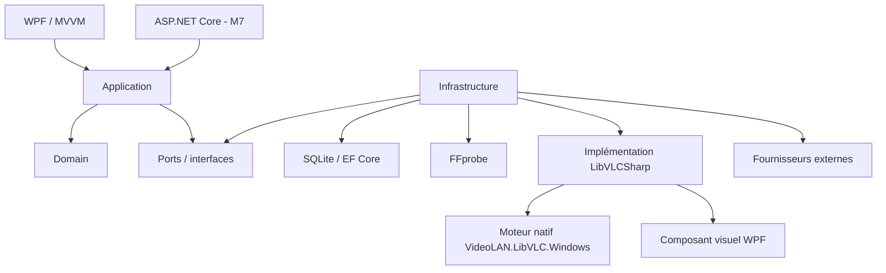

# MyVidLib - Architecture logicielle

**Statut :** les décisions d'architecture ci-dessous complètent les arbitrages du socle initial. Les sujets explicitement marqués **À DÉFINIR** restent ouverts.

## Objectifs

- Isoler l'interface WPF de la logique métier.
- Permettre le fonctionnement local hors ligne.
- Permettre l'évolution vers une API ASP.NET Core au jalon M7.
- Centraliser les accès aux données et les chemins physiques.
- Rendre les fournisseurs externes remplaçables.
- Préserver les fichiers originaux sans déplacement, renommage ou suppression automatique.
- Maintenir la distinction entre œuvre logique et fichier physique, ainsi que la provenance des métadonnées et le suivi individuel.

## Organisation des projets

Les projets du socle initial sont :

```text
MyVidLib.sln
src/
  MyVidLib.Domain/
  MyVidLib.Application/
  MyVidLib.Infrastructure/
  MyVidLib.Wpf/
  MyVidLib.Api/                 (créé uniquement au jalon M7)
tests/
  MyVidLib.Domain.Tests/
  MyVidLib.Application.Tests/
  MyVidLib.Infrastructure.Tests/
  MyVidLib.Wpf.Tests/           (si nécessaire)
```



## Responsabilités

### Domain

Entités, objets valeur, invariants et règles métier indépendantes de toute technologie. Aucune dépendance à EF Core, WPF, HTTP ou au système de fichiers.

### Application

Cas d'utilisation, DTO, interfaces de dépôts et de services, orchestration et gestion des opérations asynchrones. Cette couche déclare notamment l'abstraction applicative du lecteur et les capacités de résolution des chemins nécessaires aux cas d'utilisation.

### Infrastructure

Implémentations EF Core/SQLite, scanner, résolution des chemins physiques, exécution de FFprobe, fournisseurs HTTP, caches, stockage d'images, journalisation et implémentation LibVLCSharp de l'abstraction du lecteur.

### WPF

Views, ViewModels, navigation, ressources visuelles, commandes et composant visuel WPF du lecteur. Les ViewModels dépendent des cas d'utilisation et abstractions d'Application, et ne manipulent directement ni les objets natifs VLC ni les chemins physiques.

### API

Le projet `MyVidLib.Api` est créé uniquement au jalon M7. Il expose les cas d'utilisation et services applicatifs avec une politique d'autorisation adaptée au partage réseau. L'hébergement dans le processus WPF ou dans un processus séparé reste **À DÉFINIR**.

## Lecteur vidéo

La lecture sépare trois responsabilités :

1. **Abstraction applicative** dans Application : commandes/capacités de lecture accessibles aux cas d'utilisation et ViewModels sans dépendance au moteur.
2. **Implémentation LibVLCSharp** dans Infrastructure : adaptation de l'abstraction aux API gérées et au moteur natif VLC.
3. **Composant visuel WPF** dans WPF : affichage de la vidéo et liaison à l'implémentation au moyen d'une intégration définie par la composition racine.

Les ViewModels ne manipulent pas directement les objets natifs VLC. Le déploiement des dépendances natives est vérifié et testé avec la publication de l'application.

## Scanner et sources

La découverte et la réconciliation des médias combinent :

- `FileSystemWatcher` pour les changements observables ;
- des scans périodiques ;
- des scans manuels ;
- une réconciliation avec l'index pour retrouver les écarts et traiter les événements manqués.

Une indisponibilité de source locale, amovible ou UNC ne doit jamais provoquer la suppression de ses fichiers de l'index. Elle est signalée et peut être réessayée. La détection d'un fichier réellement supprimé doit être signalée et ne pas entraîner une suppression silencieuse. Les événements du système de fichiers ne remplacent pas les scans de réconciliation.

## Chemins physiques

La résolution et la gestion des chemins locaux, externes et UNC sont centralisées derrière une responsabilité de service dans Application et son implémentation dans Infrastructure. La normalisation, la vérification d'accès et les erreurs de disponibilité sont traitées à cet endroit.

Les Views et ViewModels ne construisent, ne normalisent et ne vérifient pas directement les chemins physiques. Aucun chemin d'installation de ressource native n'est codé en dur ; les chemins FFprobe et VLC sont résolus via une configuration centralisée.

## Règles de dépendances

- Les couches externes dépendent des couches internes.
- `Domain` ne dépend d'aucun autre projet applicatif.
- `Application` dépend de `Domain` uniquement.
- `Infrastructure` implémente les ports définis par `Application`.
- `Wpf` dépend d'`Application` et peut référencer `Infrastructure` uniquement pour la composition racine.
- `Api` (à partir de M7) dépend d'`Application` et peut référencer `Infrastructure` uniquement pour la composition racine.
- L'utilisation directe de `DbContext` hors d'`Infrastructure` est interdite.

## Injection de dépendances

Chaque projet hôte compose ses services au démarrage. Conserver les extensions d'enregistrement par module (`AddMyVidLib...`) dans les projets concernés. Ne pas multiplier les couches ou abstractions sans justification par une responsabilité ou un besoin concret.

Les durées de vie doivent respecter les unités de travail et les contraintes de concurrence. La configuration détaillée de la concurrence WPF/API reste **À DÉFINIR** avant M7.

## Communication WPF et traitements en arrière-plan

Les ViewModels appellent des cas d'utilisation asynchrones et exposent des états explicites. Aucun écran ne réalise un scan complet sur le thread UI. Les opérations longues :

- affichent une progression lorsque pertinent ;
- acceptent et transmettent un `CancellationToken` ;
- journalisent les erreurs utiles ;
- conservent une bibliothèque utilisable pendant le traitement.

La surveillance peut s'appuyer sur un service d'arrière-plan. Chaque tâche est isolée et annulable ; les erreurs répétitives sont agrégées dans l'historique de scan. L'indisponibilité d'une source ne bloque pas les autres.

## Gestion des erreurs et journalisation

- Les couches d'infrastructure exposent les erreurs techniques sans les masquer.
- Les erreurs métier utilisent des résultats fortement typés ou des exceptions applicatives documentées.
- WPF/API convertissent les erreurs en messages compréhensibles pour l'utilisateur.
- Serilog fournit des logs structurés avec opération et identifiant de corrélation lorsque pertinent.
- Ne jamais journaliser de secrets ou de données sensibles inutiles ; éviter les chemins et données personnelles non nécessaires.

## Base de données et concurrence

- Utiliser EF Core Migrations.
- Créer un `DbContext` par unité de travail.
- Ne jamais partager un même `DbContext` entre des opérations concurrentes.
- Utiliser des transactions lorsque la cohérence d'une opération le nécessite, notamment pour la réconciliation des scans et le remplacement d'associations.
- Préparer la stratégie de concurrence WPF/API avant M7 ; la stratégie définitive reste **À DÉFINIR**.

## Tests

- **Domain** : invariants et règles métier.
- **Application** : cas d'utilisation avec dépôts et services simulés.
- **Infrastructure** : migrations et SQLite, systèmes de fichiers temporaires, chemins locaux/UNC, indisponibilité de sources, parsing FFprobe et fournisseurs via mocks HTTP.
- **FFprobe et configuration** : disponibilité, chemins résolus depuis la configuration, échecs de lancement et de traitement.
- **WPF** : ViewModels et navigation sans dépendance à l'affichage réel ; intégration lecteur testée séparément selon ce qui peut être validé sans interface.
- **Publication** : vérification des ressources natives distribuées et test sur une machine sans SDK .NET.
- **API (M7)** : authentification, autorisations et requêtes HTTP Range.

Voir [pile technique](TECHNICAL_STACK.md), [modèle de données](DATA_MODEL.md), [conventions de code](CODING_CONVENTIONS.md) et [notes de revue technique](TECHNICAL_REVIEW_NOTES.md).
