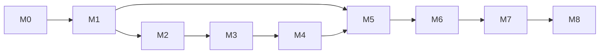

# MyVidLib - Feuille de route

**Statut :** PROPOSÉ. Les milestones définissent l'ordre cible, pas des travaux réalisés.

## Principe

Chaque milestone doit être implémenté, testé, documenté et validé avant le suivant. Les missions M0 et M1 sont décomposées ci-dessous.

## M0 - Initialisation technique

**Objectif :** établir une solution compilable, testable et documentée.

**Fonctionnalités :** dépôt, solution, projets, configuration EF/SQLite, conventions, premier test.

**Prérequis :** arbitrages techniques minimaux de M0.

**Critères :** solution compilée, test exécuté, architecture .NET cohérente.

**Livrables :** solution, projets, test, configuration de dépendances.

**Risques :** versions SDK .NET/Visual Studio incompatibles, choix NuGet prématuré.

### M0.1 - Initialisation du dépôt

Git, .gitignore, README et structure minimale. Statut initial : non commencé.

### M0.2 - Création de la solution .NET

Solution Visual Studio et projets principaux proposés. Statut initial : non commencé.

### M0.3 - Configuration des projets

C# 14, .NET 10, NRT, références entre couches, packages validés. Statut initial : non commencé.

### M0.4 - Première compilation

Compilation propre sans avertissement bloquant. Statut initial : non commencé.

### M0.5 - Mise en place des tests

xUnit et premier test minimal. Statut initial : non commencé.

## M1 - Bibliothèque locale

**Objectif :** indexer et afficher une bibliothèque locale réelle.

**Fonctionnalités :** modèle initial, sources, scanner, FFprobe, interface, recherche, ouverture.

**Prérequis :** M0 validé, modèle de données arbitré.

**Critères :** scan réel, index persistant, affichage, recherche, ouverture sans modification du fichier.

**Livrables :** bibliothèques, données SQLite, écran WPF et tests.

**Risques :** chemins réseau, grosses bibliothèques, verrouillage, disponibilité FFprobe.

### M1.1 - Modèle de données

EF Core pour les entités nécessaires à la bibliothèque locale. Validation humaine requise.

### M1.2 - Gestion des dossiers sources

Ajout, validation, activation, désactivation et retrait des MediaRoots.

### M1.3 - Scanner récursif

Parcours des extensions, détection des changements et historique.

### M1.4 - Indexation

Persistance des MediaFiles, chemins normalisés, doublons et statuts.

### M1.5 - Analyse FFprobe

Extraction de la durée, résolution, codecs, pistes, sous-titres et FPS.

### M1.6 - Interface de bibliothèque

Navigation, cartes/listes, fiche détaillée et indicateurs de disponibilité.

### M1.7 - Recherche et filtres

Recherche locale, filtres et tri initial.

### M1.8 - Ouverture des vidéos

Lecteur externe Windows ou lien de lecture préparé selon l'architecture.

### M1.9 - Validation de M1

Tests, compilation, scénario utilisateur complet et mise à jour de documentation.

## M2 - Métadonnées TMDB

**Objectif :** enrichir films et séries via TMDB.

**Fonctionnalités :** recherche, candidats, association confirmée, provenance, cache, affiches.

**Prérequis :** M1, modèle externe, configuration des clés.

**Critères :** métadonnées récupérées, candidats incertains validés, fonctionnement hors ligne sur le cache.

**Risques :** API, quotas, licences, qualité des correspondances.

## M3 - Connecteur Animeka

**Objectif :** ajouter Animeka aux catalogues d'animés.

**Prérequis :** M2, modèle multi-sources, accès/licence vérifiés.

**Risques :** disponibilité du service, structure du site/API, droits d'utilisation.

## M4 - Anime-Sama et comparateur

**Objectif :** compléter les catalogues animés et comparer les épisodes locaux.

**Fonctionnalités :** Anime-Sama, titres alternatifs, OAV, épisodes spéciaux, doubles, validation manuelle.

**Prérequis :** M3, modèle d'épisodes, identifiants et association.

## M5 - Suivi des visionnages

**Objectif :** gérer profils, historique, progression et reprise.

**Prérequis :** M1, modèle utilisateurs validé, accès aux positions de lecture.

## M6 - Lecteur vidéo

**Objectif :** intégrer LibVLCSharp.

**Prérequis :** M1, suivi M5 préparé, distribution VLC arbitrée.

**Fonctionnalités :** lecture, pistes, sous-titres, reprise, épisode suivant.

## M7 - Partage réseau

**Objectif :** activer l'API et interface web locales.

**Prérequis :** M5/M6, authentification, politique réseau, HTTP Range.

**Risques :** sécurité, accès aux chemins, compatibilité navigateurs.

## M8 - Finalisation et packaging

**Objectif :** fiabiliser, optimiser et distribuer.

**Prérequis :** M0-M7 validés.

**Fonctionnalités :** sauvegarde/restauration, logs, statistiques, packaging Windows, documentation finale.

**Livrables :** build installable, tests complets, manuel utilisateur minimal.

## Dépendances globales

Voir [le milestone courant](CURRENT_MILESTONE.md), [les tâches](../05_AI_WORKFLOW/TASK_TEMPLATE.md) et [la vision](../00_VISION/PROJECT_VISION.md).